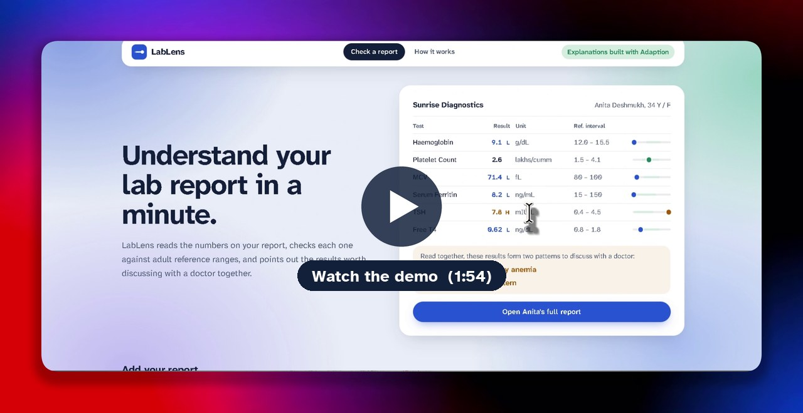
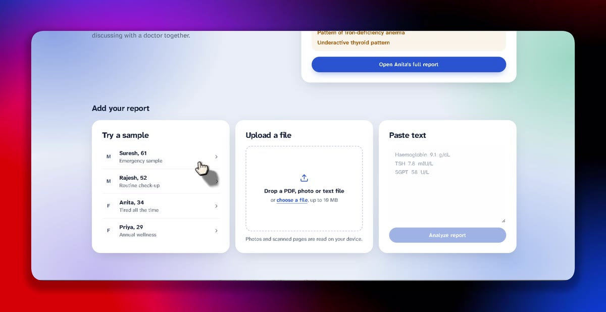
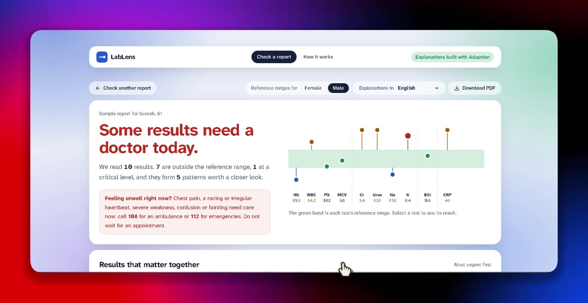
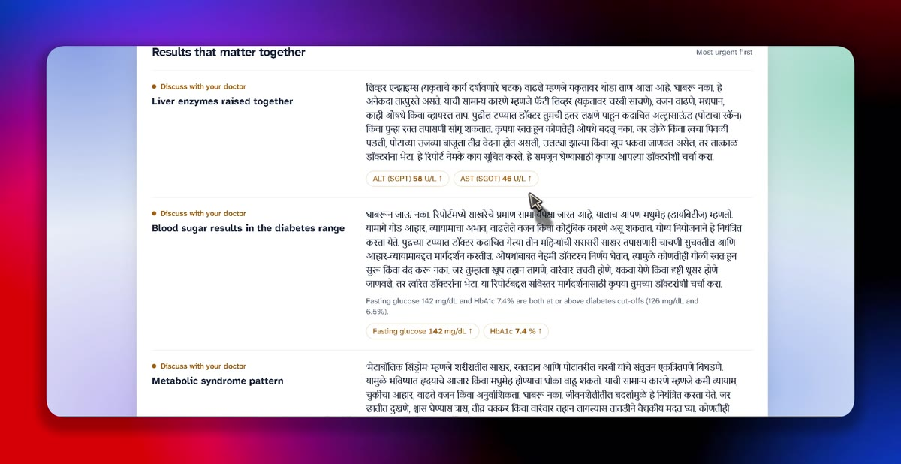
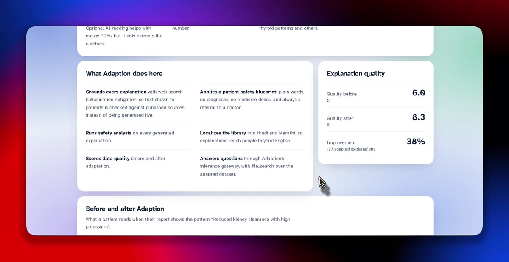
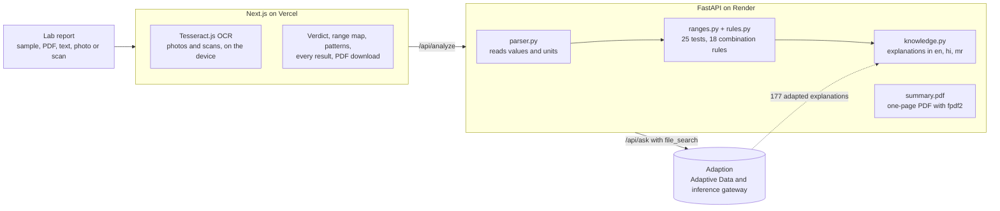

<div align="center">


# LabLens

**Understand your lab report in a minute.**

LabLens reads a medical lab report, flags every result outside its reference range, and points out the
combinations of results that need a doctor's attention, explained in plain English, Hindi or Marathi.

[**Open the live app**](https://lablens-orca-coder.vercel.app) &nbsp;|&nbsp;
[**Watch the demo**](docs/lablens-demo.mp4) &nbsp;|&nbsp;
[How it works](https://lablens-orca-coder.vercel.app/how-it-works) &nbsp;|&nbsp;
[API health](https://lablens-api-9jjf.onrender.com/api/health)

[](https://lablens-orca-coder.vercel.app)
[](#how-adaption-is-used)
[](frontend)
[](backend)

</div>

<br />

<a href="docs/lablens-demo.mp4"></a>

| 25 | 18 | 3 | 177 | 6.0 → 8.3 |
|:---:|:---:|:---:|:---:|:---:|
| lab tests with sex-specific ranges | rules for risky combinations | languages: English, Hindi, Marathi | explanations adapted by Adaption | explanation quality before and after Adaption |

## The problem

> Develop an intelligent medical report analyzer that detects abnormal health indicators and identifies potentially
> concerning combinations of results.

A lab report is a page of numbers. Patients see a value marked "H" and either panic or ignore it, and a single
result rarely tells the whole story: low haemoglobin with low MCV and low ferritin means something different from
low haemoglobin alone. LabLens answers each part of the brief:

| The brief asks to | LabLens |
|---|---|
| Analyse sample medical reports | Reads PDFs, text, pasted results, phone photos and scanned PDFs, written the way Indian labs write them |
| Flag values outside predefined reference ranges | Checks 25 tests against sex-specific adult ranges and critical limits, and shows each value on its own range bar |
| Highlight combinations that may need medical review | 18 written rules find patterns such as kidney decline with high potassium, ranked from "See a doctor today" down to "Keep an eye on" |

## Screenshots

<table>
  <tr>
    <td width="50%"></td>
    <td width="50%"></td>
  </tr>
  <tr>
    <td><b>Add a report.</b> Try a sample, upload a PDF, photo or scan, or paste the results.</td>
    <td><b>See the verdict first.</b> A range map shows every result against its own reference band.</td>
  </tr>
  <tr>
    <td></td>
    <td></td>
  </tr>
  <tr>
    <td><b>Read it in your language.</b> Every explanation is available in English, Hindi and Marathi.</td>
    <td><b>Built with Adaption.</b> Grounded, safety-checked explanations, scored before and after.</td>
  </tr>
</table>

## What it does

- **Reads real Indian lab reports.** It understands lab spellings and units such as Haemoglobin, SGPT, TLC,
  "2.6 lakhs/cumm" and "1,62,000 /cumm". Photos and scans are read in the browser with OCR, so the image never
  leaves the device; only the extracted text is analysed.
- **Flags every value** against sex-specific adult reference ranges and critical limits across blood count, sugar,
  kidney and electrolytes, liver, lipids, thyroid, vitamins and inflammation.
- **Finds concerning combinations** such as iron-deficiency anemia, kidney decline with high potassium, metabolic
  syndrome, liver enzymes rising together, thyroid patterns and pancytopenia.
- **Ranks by urgency** and tells patients with urgent results when to call 108 or 112 instead of waiting.
- **Explains each flag** in plain words, in English, Hindi or Marathi.
- **Exports a one-page PDF** with the verdict, the patterns and every result, to take to the doctor.
- **Answers questions** about the report through Adaption's inference gateway (switched on when `ADAPTION_MODEL`
  is set).

### What the four sample reports show

| Sample | Verdict | What LabLens finds |
|---|---|---|
| Suresh, 61 (emergency) | See a doctor today | Reduced kidney clearance with high potassium, potassium at a critical level, kidney markers raised together, anemia with reduced kidney function, signs of infection |
| Rajesh, 52 (routine check-up) | Discuss with your doctor | Liver enzymes raised together, blood sugar in the diabetes range, metabolic syndrome, cholesterol pattern linked to heart risk |
| Anita, 34 (tired all the time) | Discuss with your doctor | Iron-deficiency anemia, underactive thyroid |
| Priya, 29 (annual wellness) | Everything in range | Nothing to flag |

### Safety by design

- **AI never decides what is abnormal.** Every flag traces back to a number in
  [`ranges.py`](backend/lablens/ranges.py) or a rule in [`rules.py`](backend/lablens/rules.py).
- **Explanations are prepared ahead of time,** then grounded and safety-checked by Adaption, rather than generated
  live for each patient.
- **No diagnoses and no medicine doses.** Every explanation ends with a referral to a doctor.
- **Photos stay on the device.** OCR runs in the browser.

## How Adaption is used

| Adaption feature | How LabLens uses it |
|---|---|
| Adaptive Data `adapt` | Improves the 60-row patient explanation library |
| `hallucination_mitigation` | Web-search grounding, so patients never see invented medical claims |
| `blueprint` | Patient-safety style: plain words, no diagnosis, no doses, always refer to a doctor |
| `safety_categories` | Safety analysis on every generated explanation |
| `language_expansion` (localize, IN) | Hindi and Marathi versions of every explanation |
| Evaluation | Quality score before and after, shown in the app |
| Inference gateway `responses.create` + `file_search` | "Ask about this report", grounded in the adapted dataset |

**Result:** explanation quality rose from **6.0 to 8.3** (grade **C → B**, **+38%**), across 177 adapted
explanations in English, Hindi and Marathi. The pipeline is [`backend/adaption_build.py`](backend/adaption_build.py).

**One explanation before and after Adaption**, for the pattern "Reduced kidney clearance with high potassium":

<table>
  <tr>
    <th width="50%">Our draft</th>
    <th width="50%">After Adaption: grounded, safety-checked, patient-friendly</th>
  </tr>
  <tr>
    <td valign="top">High creatinine suggests the kidneys are filtering less well, and high potassium can build up when
    they do. High potassium can affect heart rhythm, so this combination should be checked by a doctor the same
    day. This is not a diagnosis; please discuss it with your doctor.</td>
    <td valign="top">Reduced kidney clearance means your kidneys are filtering waste slower than usual. When this
    happens, potassium—a mineral that helps your muscles and heart work—can build up in your blood. Common causes
    include dehydration, certain medicines, or long-term health issues like diabetes. Usually, your doctor will
    review your history and may repeat the test to confirm. They might suggest simple diet changes or a review of
    your medicines. Do not start or stop any pills on your own. High potassium can sometimes affect heart rhythm, so
    please see a doctor soon if you feel very weak, have chest pain, or notice an irregular heartbeat. Stay
    calm—this is often manageable. Please discuss these results with your doctor for advice tailored to you.</td>
  </tr>
</table>

## Architecture



```
backend/
  main.py              FastAPI app: analyze, file upload, scanned pages, PDF summary, ask
  pdf_summary.py       one-page PDF for the doctor
  adaption_build.py    Adaption pipeline: seed, estimate, run, status, fetch
  lablens/             the analysis engine: parser, ranges, rules, knowledge, ai
  data/                seed explanations, Adaption output and quality scores
  samples/             four demo reports
  test_lablens.py      engine tests
frontend/
  app/                 the report page and How it works
  components/          results, range map, range bars, ask, Adaption stats
  lib/                 typed API client, OCR, formatting
streamlit_app.py       the original Streamlit version, kept as a fallback
```

## Run locally

Backend (Python 3.12):

```bash
cd backend
pip install -r requirements.txt
cp .env.example .env            # optional: Adaption and Langfuse keys
python test_lablens.py          # All 7 tests passed.
uvicorn main:app --reload --port 8000
```

Frontend (Node 20+):

```bash
cd frontend
npm install
npm run dev                     # http://localhost:3000, talks to http://localhost:8000
```

The app works with no keys at all. The original Streamlit version still runs from the repo root:
`pip install -r requirements.txt && streamlit run streamlit_app.py`.

<details>
<summary><b>Rebuild the explanation library with Adaption</b></summary>

```bash
cd backend                          # reads ADAPTION_API_KEY from backend/.env
python adaption_build.py estimate   # price it first
python adaption_build.py run        # grounding + safety + blueprint + Hindi/Marathi
python adaption_build.py status
python adaption_build.py fetch      # saves data/adapted/ and data/adaption_eval.json
```

Commit the files in `backend/data/`, and the deployed app picks them up automatically.

</details>

<details>
<summary><b>Deploy</b></summary>

- **Backend on Render:** root directory `backend`, build `pip install -r requirements.txt`, start
  `uvicorn main:app --host 0.0.0.0 --port $PORT`, variables from `backend/.env.example`.
- **Frontend on Vercel:** root directory `frontend`, variable `NEXT_PUBLIC_API_URL` set to the Render URL.

Render's free tier sleeps, so the first request after a quiet spell can take up to a minute.

</details>

## Tech and AI tools

- Python, FastAPI, pandas, pypdf, pypdfium2, fpdf2
- Next.js, React, TypeScript, Tailwind CSS
- Tesseract.js (in-browser OCR for photos and scans)
- Adaption (Adaptive Data, localization, evaluation, inference gateway)
- Langfuse (tracing of AI calls)
- Render and Vercel (hosting)
- Claude, used as a coding assistant

## Disclaimer

LabLens is not a diagnostic tool. Reference ranges are typical adult values and differ between labs, so compare with
the range printed on your report. If you feel unwell, contact a doctor whatever these results say.
